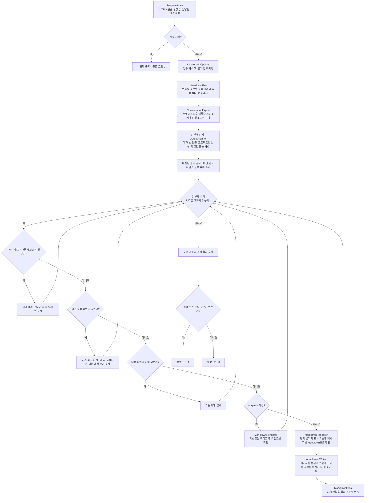

# MarkdownConverter 실행 흐름

프로그램은 내보낸 대화 JSON을 두 번 읽습니다. 첫 번째 읽기에서 대화별 출력 경로를 확정하고, 두 번째 읽기에서 기존 파일을 이전하거나 새 Markdown을 기록합니다.

- 기본 출력 경로는 실행 디렉터리 아래의 서울 시각 `yyyyMMdd-HHmm` 폴더입니다. `--output`을 지정하면 해당 경로를 사용합니다.
- 출력 파일명은 `제목_yyyyMMdd_HHmmss.md` 형식입니다. 같은 이름이 겹치면 대화 ID 순서에 따라 `_2`부터 번호를 붙입니다.
- 대화 처리 중 프로그램이 처리할 수 있는 예외는 해당 대화의 실패로 집계하고 다음 대화를 처리합니다. 준비 단계에서 처리할 수 있는 오류가 나면 오류를 표시하고 종료 코드 1을 반환합니다.
